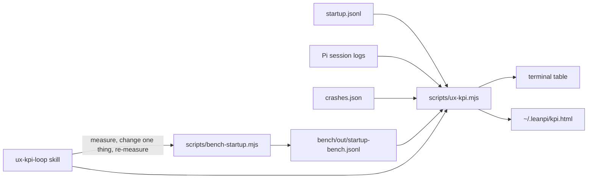

# PRD-054 — UX KPIs, a dashboard, and a loop to improve them

**Status:** IN PROGRESS
**Priority:** P1 — no KPI, dashboard or startup bench exists yet (AC-1 to AC-5 open); the operator reports slow starts with no number to track.
**Complexity:** 3 (LOW)
**Owner:** Joao
**Depends on:** None

## Context

The operator says LeanPi "takes too long to start" and wants UX KPIs, a dashboard, and a loop skill to improve them.

The data already exists on disk. Nothing reads it back:

- `~/.leanpi/startup.jsonl` — one line per launch process, written by `src/cli/startup-trace.ts`. The `pi` line has `marks.editor-painted` (ms from launch to a usable editor) and Pi's `PI_TIMING` block (per-extension import times). 178 painted launches since 2026-09-23. Organic p50 2350 ms, p90 8984 ms. The last launch took 12778 ms: `createAgentSessionRuntime` 8412 ms, `extensions/compact-ui/index.ts module import` 2442 ms.
- `~/.pi/agent/sessions/*/*.jsonl` — every turn. An assistant entry has `message.timestamp` (request start), the entry `timestamp` (end) and `message.stopReason` (`stop`, `toolUse`, `error`, `aborted`). Over all sessions: 444 `stop`, 89 `error`, 67 `aborted`.
- `~/.pi/agent/crashes.json` — uncaught exceptions with timestamps.

## Solution

One script reads the logs and computes the KPIs. One script measures startup under a controlled pty. One page shows both. One skill loops on the worst red KPI.

KPIs (last 30 days by default, `--days N` to change, compared with the window before, with a 30-day daily series). Usage is bursty: the last 7 days held 2 launches and 1 turn, so 7 days is too thin for a default.

| KPI | Source | Target |
|---|---|---|
| Time to editor p50 | `startup.jsonl` `editor-painted` | ≤ 2500 ms |
| Time to editor p90 | same | ≤ 5000 ms |
| First reply p50 (user message → first assistant message done) | session logs | ≤ 10 s |
| Turns ending in error | last assistant `stopReason` per user turn | ≤ 2% |
| Turns aborted by the user | same | ≤ 5% |
| Crashes | `crashes.json` | 0 |

The page also shows the startup phase breakdown (launcher imports, extension load, session runtime, paint) and the slowest Pi extension imports. These are the levers the loop needs.

The bench launches the real `bin/leanpi.js` N times under `script` (a pty), sets `LEANPI_T0`, waits for the matching `editor-painted` line, then kills the process. Each run appends one row (date, git sha, Pi version, p50, p90, phase p50s) to `bench/out/startup-bench.jsonl`. The rows are committed, so the history follows the code.

## Acceptance Criteria

- [x] AC-1 [local]: `pnpm kpi` prints the six KPIs with value, target, pass/fail and the delta against the previous window from the real logs. proof: `pnpm kpi` — 2026-10-23: 156 launches, 366 turns, ready p50 2566 ms, error 8.6%, abort 11.0%.
- [x] AC-2 [local]: `pnpm kpi` writes `~/.leanpi/kpi.html` with KPI tiles, 30-day sparklines, startup breakdown and bench history. proof: open the page in a browser — headless Chromium screenshots at 1200 px (light, dark) and 400 px.
- [x] AC-3 [local]: KPI math is correct on a fixture (percentiles, turn-end classification, first reply). proof: `pnpm vitest run tests/ux-kpi.test.ts` — 4 passed.
- [x] AC-4 [local]: `pnpm bench:startup -- --runs 5` launches LeanPi 5 times and appends one row to `bench/out/startup-bench.jsonl`. proof: the command and the new row — 5/5 runs, p50 4822 ms, p90 9690 ms, row at `fc56a1a-dirty`.
- [ ] AC-5 [local]: `/loop /ux-kpi-loop` is a usable skill: it measures, picks the worst red KPI, makes one change, re-measures, and keeps or reverts. proof: `.claude/skills/ux-kpi-loop/SKILL.md` loads in Claude Code
- [x] AC-6 [local]: No regression. proof: `pnpm test`, `pnpm typecheck`, `pnpm lint` — typecheck exit 0. Lint exit 0, with two existing warnings in files this PRD did not change. Tests: 1127 passed, 1 failed (`tests/bootstrap.spec.ts` AC-1 at load 55). That file passed 5/5 when run alone.

## Integration Ledger

| Capability | Reachable consumer/trigger | Replaces / disposition | Evidence |
|---|---|---|---|
| KPI report + page | `pnpm kpi` → `scripts/ux-kpi.mjs` | new; first reader of `startup.jsonl` | AC-1, AC-2 |
| Startup bench | `pnpm bench:startup` → `scripts/bench-startup.mjs` → `bin/leanpi.js` | new | AC-4 |
| Loop skill | `/ux-kpi-loop` or `/loop /ux-kpi-loop` | new | AC-5 |

## Execution Phases

#### Phase 1: KPI report and dashboard
**Status:** DONE
**Files:** `scripts/ux-kpi.mjs`, `scripts/ux-kpi-dashboard.html`, `tests/ux-kpi.test.ts`, `package.json` (`kpi` script)
**Verification:** AC-1, AC-2, AC-3

#### Phase 2: Startup bench
**Status:** DONE
**Files:** `scripts/bench-startup.mjs`, `package.json` (`bench:startup` script)
**Verification:** AC-4

#### Phase 3: Loop skill and docs
**Status:** IN PROGRESS
**Blocker:** AC-5 needs a new Claude Code session, because skills load at session start.
**Files:** `.claude/skills/ux-kpi-loop/SKILL.md`, `docs/benchmarks/ux-kpis.md` (KPI definitions and the loop's learnings log)
**Verification:** AC-5, AC-6
