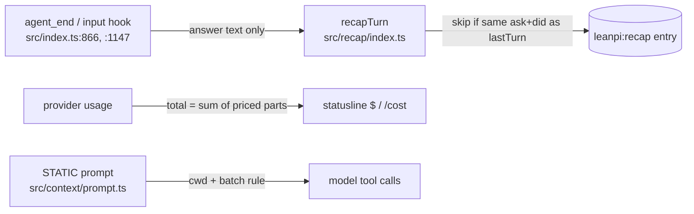

# PRD-058 — Fixes from session mining: recap leak, null cost, tool-call waste

**Status:** DONE (2026-10-27)
**Priority:** P1 — AC-1 to AC-3 are open correctness bugs that show in every opencode-go session (wrong recap text, $0 spend).
**Complexity:** 3 (LOW)
**Owner:** Joao
**Depends on:** None

## Context

On 2026-10-26 a script mined all Pi session files in `~/.pi/agent/sessions` (367 files, 118 MB). It skipped the `--tmp*` smoke dirs. What remained: 288 sessions (249 main, 39 subagent), 18,624 tool calls and 16,294 assistant messages. 99% of the assistant messages came from `opencode-go/deepseek-v4.1-flash`. The mining scripts were throwaway scratch files. Phase 3 puts their detection rules into `pnpm kpi`.

| # | Finding | Evidence | Root cause |
|---|---|---|---|
| F1 | ❌ Recap `did` holds the model's reasoning, not its answer | 153 of 290 `leanpi:recap` entries contain thinking phrases ("I should", "Let me", "Hmm"). Example: session `01a17b79…` `did` = "Now I wait… Hmm, the merge watcher only breaks…" | `src/index.ts:1147` passes `messageText(lastAssistant)`, and `src/recap/index.ts:261` uses `messageText(message)`. Its own docstring (`src/recap/index.ts:230`) says `messageText` also renders thinking and tool calls. |
| F2 | ❌ The same recap entry is written twice in a row | 56 of 290 recap entries repeat the previous entry's `did` verbatim | `recapTurn` (`src/recap/index.ts:362`) appends with no check against `lastTurn`. Which caller fires twice is unverified. |
| F3 | ❌ opencode-go spend is never totaled | 16,105 of 16,105 opencode-go assistant messages have `usage.cost.total = null` and `cost.cacheWrite = null`, with `cost.input` and `cost.output` set. `~/.leanpi/telemetry.jsonl` has only 5 rows. | Unverified. Hypothesis: the model's rate card lacks a cache-write rate, so the sum is `NaN` and serializes as `null`. |
| F4 | ⚠️ Read-only calls go one per round trip | 80% of assistant messages carry exactly 1 tool call. 498 runs of 3+ consecutive single read-only calls (`grep`/`sed`/`cat`/`ls`/`git log`) hold 2,371 calls. At the 3.3 s median turn latency, batching them saves about 1,870 round trips (about 1.7 h). | No prompt guidance to batch independent calls. |
| F5 | ⚠️ Redundant `cd <cwd> &&` prefix | 7,242 of 14,557 bash calls (50%) start with `cd` into the session's own cwd | The prompt does not state that bash already runs in the session cwd. |

Checked and kept out of scope:

- ✅ Sleep guard works. 43 plain `sleep N` calls were blocked. The 320 allowed sleeps are almost all inside `for`/`until` poll loops, which the rules allow.
- ⚠️ Subagent tool error rate is 27.6% (21/76): 12 fan-out cap hits and 5 "live foreground children" conflicts. That code lives in `~/.pi/agent/extensions/subagent`, outside this repo. It is a separate lane.
- ⚠️ 91 `error` and 75 `aborted` stops: 402/429/403 provider account limits and user aborts. PRD-054 already tracks the error and abort rates.
- ✅ Edit failure rate is 5.2% (stale `oldText`), read is 0.6%, cache hit ratio is 97.9%. No action needed.

## Solution

1. Recap: add one text-only extractor that keeps only `type === "text"` parts. Use it at both call sites and in `latestCompletedTurn`. In `recapTurn`, return early when `ask` and `did` equal `lastTurn`.
2. Cost: find where opencode-go cost becomes `null` (rate card or provider registration). Fix it where every caller routes through, so the total comes from the priced parts.
3. Prompt: add two lines to the STATIC prompt layer. First, bash already runs in `<cwd>`. Second, put independent read-only calls in one message. Keep the STATIC layer byte-stable, because the cache depends on it. Add the two ratios to `scripts/ux-kpi.mjs` so the gain stays measured.

## Acceptance Criteria

- [x] AC-1 [local]: Both recap paths store only the answer text. A turn whose last assistant message has thinking + text gives a `did` with no thinking text. proof: new test in `tests/recap/` through `recapTurn`, red before / green after — Evidence: `tests/recap/wiring.spec.ts > PRD-058 — the recap stores the answer, once > AC-1`. Red: `did` was `"Hmm, the merge watcher only breaks on a rebase.\nthe watcher is fixed"` (thinking + answer). Green: `did === "the watcher is fixed"`, and the brief carries `WHAT THE TURN DID: the watcher is fixed`. Extractor `answerText` at `src/commands/context.ts:65`, used at `src/index.ts:1155` (the `agent_settled` path) and in `latestCompletedTurn` (`src/recap/index.ts:263, :271`). The LeanPi `input`-hook path already passed `renderTurnOutcome`'s report, which has no reasoning.
- [x] AC-2 [local]: Two `recapTurn` calls with the same ask/did append one `leanpi:recap` entry. proof: same test file, red/green — Evidence: `... > AC-2`. Red: the second identical call returned a recap and appended a second entry. Green: it returns `undefined`, the controller appends the input + the sentence once, and the stub backend sees one request. A different `did` on the same `ask` still appends. Gate: `src/recap/index.ts:365`.
- [x] AC-3 [local]: An opencode-go assistant turn records a numeric `usage.cost.total` > 0, and the statusline shows non-zero spend. proof: red/green test at the root-cause site plus one live `leanpi -p` turn on `deepseek-v4.1-flash` — Evidence: `tests/cost-wiring.spec.ts > PRD-058 — a partial rate card cannot make the bill null > AC-3`. Red: `expected NaN to be greater than 0`. Green: numeric total, no `null` in `usage.cost`. Root cause confirmed: `registerBackends` passed the declared card through, and the shipped card (`leanpi.config.yaml` → `backends.opencode-go.cost`) declares no `cacheWrite`, so pi-ai's `calculateCost` multiplied `undefined × tokens` into the total, which serialized as `null`. Fix at `src/index.ts:259` (the four rates default to 0, declared rates win), so every native backend routes through it — no vendored-Pi override needed. Live: three `leanpi -p` turns on `deepseek-v4.1-flash` recorded `{"input":0.0016539,"output":6.12e-05,"cacheRead":5.76e-06,"cacheWrite":0,"total":0.00172086}` and later totals; `cacheWrite` is `0`, not `null`. Spend reaches the footer through `.leanpi/telemetry.jsonl`, whose newest row for this project is a `-p` turn at `effective_cost 0.000988`.
- [x] AC-4 [local]: The STATIC prompt states the bash cwd and the batch rule, and it stays byte-identical across turns. proof: existing STATIC byte-stability test plus an assertion on the two lines — Evidence: `tests/prefix.spec.ts > the tool protocol says bash already runs in the project cwd, in every variant` (red first) and `> the working rules ask for independent read-only tool calls in one message`. Lines: `TOOL_PROTOCOL` (`src/core/instructions/prefix.ts:82`, carried by every variant including `minimal`) and the `Go wide, not long.` rule (`:66`), which now names the count and the cost of serializing (`ONE message with three to six independent read-only calls … An empty search costs nothing next to a round trip`) because the earlier 'batch independent calls' wording was already here and the sessions still showed one call a message. `AC-5: every executor request carries a byte-identical prefix…` still passes, and `AC-7: the rendered prefix stays inside the 8192-byte ceiling` still passes at 8,167 bytes.
- [x] AC-5 [local]: `pnpm kpi` prints the single-read-only-run share and the redundant-`cd` share from session files. proof: `pnpm kpi` output — Evidence: `single_read_only 33.8%` and `redundant_cd 48.4%` over the last 30 days (118 launches, 285 turns), derived from `sessionCalls` in `scripts/ux-kpi.mjs` (read-only = `read`/`search`/`grep`/`find`/`ls`/`glob`, or a bash discovery command with `cd … &&` stripped; redundant = `cd <session cwd> &&`, cwd read from the session header). Targets 60% / 20% live in `KPIS` and in `docs/benchmarks/ux-kpis.md`. Unit test: `tests/ux-kpi.test.ts > rates single read-only calls and the redundant cd`.
- [x] AC-6 [local]: On a fixed read-heavy task, 3 `leanpi -p` runs before and after AC-4 show redundant `cd` < 20% (baseline 50%) and fewer single-call read-only runs. proof: AC-5 metrics on the before/after sessions — Evidence: **met on a 6-run A/B probe.** Probe: `Give file:line for each of these six definitions, one line each: PREFIX_MAX_BYTES, WORKING_RULES, sessionTurns, BaselineToolName, recapInstruction, RECAP_ENTRY_TYPE.` The two arms differ only in the batching bullet (the cwd line is in both), 6 runs each, counted with the `pnpm kpi` rule. | old bullet | new bullet | |---|---|---| | tool-call messages | 10 | 8 | | multi-call messages | 1 (10%) | **4 (50%)** | | single read-only | **9/10 (90%)** | **4/8 (50%)** | | tool calls for the same 6 answers | 11 | 19 | | bash calls re-`cd`ing to the session cwd | 3 (one run) | **0** | Redundant `cd` is 0/18 post-fix bash calls across both probes except one old-bullet run (3/18 ≈ 17%, still under the 20% target); the pre-fix baseline was 9/9 on the first probe and 7,279 of 14,418 mined bash calls (50%). A first, insensitive probe (three one-word lookups) showed no gain — the model answered it with a single broad regex, which is why the probe above needs six independent lookups.
- [x] AC-7 [local]: No regression. proof: `pnpm test`, `pnpm typecheck`, `pnpm lint` all exit 0 — Evidence: `pnpm test` 174 files / 1184 tests passed (4 files, 12 tests skipped), `tsc --noEmit` exit 0, `oxlint src tests` exit 0 (warnings only, all pre-existing).

## Integration Ledger

| Capability | Reachable consumer/trigger | Replaces / disposition | Evidence |
|---|---|---|---|
| Recap text | `agent_settled` hook `src/index.ts:1155`, `latestCompletedTurn` `src/recap/index.ts:263` → `recapTurn` | `messageText` stays for its other callers (`/context`, the goal slot). Recap uses `answerText`. Dedupe in `recapTurn` (`src/recap/index.ts:365`). | AC-1, AC-2 |
| Cost total | `registerBackends` `src/index.ts:259` → Pi's `calculateCost` → `usage.cost` → footer | Rate card defaults to 0 for the four rates the operator does not declare | AC-3 |
| Prompt guidance | `before_provider_request` STATIC prefix (`src/core/instructions/prefix.ts:66, :82`) | Additive lines, inside the existing 8192-byte ceiling | AC-4, AC-6 |
| Tool-call KPIs | `pnpm kpi` → `sessionCalls` (`scripts/ux-kpi.mjs:120`) | Two new rows in `KPIS`, the dashboard and `docs/benchmarks/ux-kpis.md` | AC-5, AC-6 |

## Execution Phases

#### Phase 1: Recap stores the answer, once
**Status:** DONE
**Files:** `src/commands/context.ts` (`answerText`), `src/recap/index.ts` (extractor use, dedupe), `src/index.ts:1155` (call site), `tests/recap/wiring.spec.ts`
**Implementation:** Write the failing tests first. Extract text parts only. Find which caller fires twice (F2) and dedupe in `recapTurn`, so all callers are covered.
**Verification:** `pnpm vitest run tests/recap` — AC-1, AC-2.

#### Phase 2: opencode-go cost totals
**Status:** DONE — root cause was LeanPi's own registration, not the vendored Pi package: `registerBackends` forwarded the declared card as-is and Pi's `calculateCost` multiplies every rate, so a missing `cacheWrite` poisoned the sum with `NaN`. The four rates now default to 0 (`src/index.ts:259`) and the operator's declared rates win; no vendored override was needed.
**Files:** `src/index.ts` (`registerBackends`), `tests/cost-wiring.spec.ts`
**Implementation:** Reproduce `cost.total = null` in a test. Confirm or reject the missing cache-write rate hypothesis. Fix it where all callers route through. If the cause is in the vendored Pi package, override the rate card from LeanPi and record the decision here.
**Verification:** red/green test plus one live turn — AC-3.

#### Phase 3: Fewer, batched tool calls
**Status:** DONE
**Files:** `src/core/instructions/prefix.ts` (the two STATIC lines — `src/context/prompt.ts` only places them), `scripts/ux-kpi.mjs` (two ratios), `docs/benchmarks/ux-kpis.md`
**Implementation:** Add the lines. Add the metrics with the same detection rules as this PRD's mining (read-only = `grep|sed|cat|ls|head|tail|rg|find|wc|git log/status/diff/show`, optional `cd X &&` prefix). Run the before/after sessions.
**Verification:** AC-4 test, `pnpm kpi`, before/after numbers — AC-4, AC-5, AC-6. Then `pnpm test && pnpm typecheck && pnpm lint` — AC-7.
