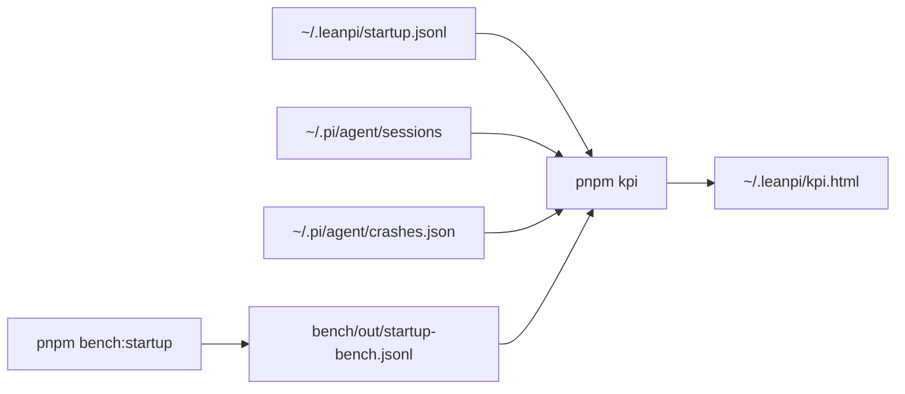

# UX KPIs

`pnpm kpi` computes these from local logs and writes the dashboard to `~/.leanpi/kpi.html`. `pnpm bench:startup` runs the controlled startup bench. The `ux-kpi-loop` skill (`.claude/skills/ux-kpi-loop/`) improves them one change at a time. Plan: [PRD-054](../PRDs/v1/PRD-054-ux-kpis.md).

| KPI | Definition | Target |
|---|---|---|
| Time to ready p50 / p90 | Shell command to the first editor frame (`editor-painted` mark, `src/cli/startup-trace.ts`) | ≤ 2500 ms / ≤ 5000 ms |
| First reply p50 | User message to the first finished assistant message | ≤ 10 s |
| Turns ending in error | Share of answered turns whose last assistant `stopReason` is `error` | ≤ 2% |
| Turns aborted | Same, `aborted` | ≤ 5% |
| Crashes | Entries in `~/.pi/agent/crashes.json` | 0 |

Targets live in `KPIS` in `scripts/ux-kpi.mjs`. Change both places together.

Startup phases: **launcher** (shell wrapper, build check, Node start, launcher imports), **pi boot** (Pi child until the LeanPi extension runs), **extensions + runtime** (the other extensions and the session), **paint** (session start to the first editor frame).

## Log

One line per loop iteration: date · KPI · lever · before → after (p50/p90) · kept/reverted · why.

- 2026-10-23 · time to ready · baseline, Pi 0.87.1 · bench p50 4822 ms / p90 9690 ms (5 runs, load 54, noisy) · — · first bench row.
