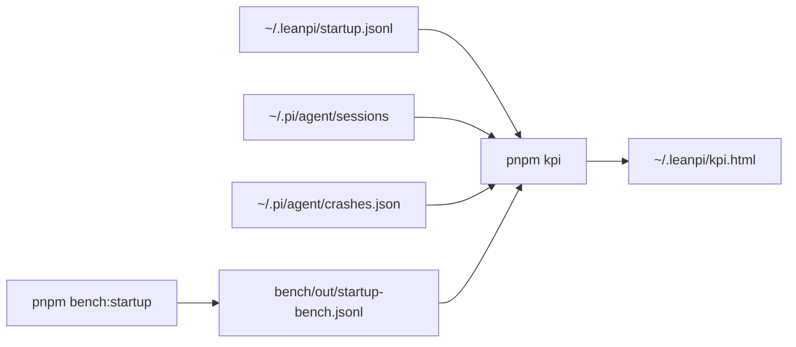

# UX KPIs

`pnpm kpi` computes these from local logs and writes the dashboard to `~/.leanpi/kpi.html`. `pnpm bench:startup` runs the controlled startup bench. The `ux-kpi-loop` skill (`.claude/skills/ux-kpi-loop/`) improves them one change at a time. Plan: [PRD-054](../PRDs/v1/PRD-054-ux-kpis.md).

| KPI | Definition | Target |
|---|---|---|
| Time to ready p50 / p90 | Shell command to the first editor frame (`editor-painted` mark, `src/cli/startup-trace.ts`) | ≤ 2500 ms / ≤ 5000 ms |
| First reply p50 | User message to the first finished assistant message | ≤ 10 s |
| Turns ending in error | Share of answered turns whose last assistant `stopReason` is `error` | ≤ 2% |
| Turns aborted | Same, `aborted` | ≤ 5% |
| Crashes | Entries in `~/.pi/agent/crashes.json` | 0 |

Targets live in `KPIS` in `scripts/ux-kpi.mjs`. Change both places together.

Startup phases: **launcher** (shell wrapper, build check, Node start, launcher imports), **pi boot** (Pi child until the LeanPi extension runs), **extensions + runtime** (the other extensions and the session), **paint** (session start to the first editor frame).

## Log

One line per loop iteration: date · KPI · lever · before → after (p50/p90) · kept/reverted · why.

- 2026-10-23 · time to ready · baseline, Pi 0.87.1 · bench p50 4822 ms / p90 9690 ms (5 runs, load 54, noisy) · — · first bench row.
- 2026-10-23 · time to ready · combined PRD-055 Phase 1 candidate (wrapper, built extensions, lazy imports) · baseline 1695/1773 ms → candidate 2323/2918 ms (p50/p90; 10 runs each, joao-cachyos, Pi 1.4.0; recorded pre-run load 4.75, post-run 13.27) · reverted · p50 rose 628 ms and p90 rose 1145 ms; retry the three stacked levers individually with comparable before/after measurements.
- 2026-10-23 · time to ready · wrapper one Node · 1745/2128 ms → 1569/1608 ms (p50/p90; 10 runs each, joao-cachyos, Pi 1.4.0; load at start 3.40/4.53) · kept · p50 fell 176 ms (10.1%), p90 fell 520 ms, launcher phase p50 fell 131 ms.
- 2026-10-23 · time to ready · lazy optional imports · 1601/1674 ms → 1694/1728 ms (p50/p90; 10 runs each, joao-cachyos, Pi 1.4.0; load at start 2.21/7.34) · reverted · p50 rose 93 ms and p90 rose 54 ms; skipping optional imports on informational launches did not offset the normal-launch import overhead.
- 2026-10-23 · time to ready · built-JavaScript default extension entries · no candidate measurement · no change · blocked before implementation: Pi 1.4.0's native ESM loading bypasses virtual modules and breaks class identity; identity-safe CommonJS still uses jiti transpilation, and dependency TypeScript cannot be relocated safely.
- 2026-10-23 · time to ready · in-process Pi handover · 1648/1683 ms → 1371/1946 ms (p50/p90; 10 runs each, joao-cachyos, Pi 1.4.0; load at start 2.25/6.15) · reverted · p50 fell 277 ms (16.8%), but p90 rose 263 ms (15.6%), failing the no-regression gate.
- 2026-10-23 · time to ready · precompiled default-extension sidecars (AC-4) · 1648/1683 ms → 1422/1448 ms (p50/p90; 10 runs each, joao-cachyos, Pi 1.4.0; load at start 2.25/9.77) · kept · p50 fell 226 ms (13.7%), p90 fell 235 ms (14.0%); all 100/100 `pi_timing` module-import paths ended in `.js`, with prototype and relocated-package checks passing.
