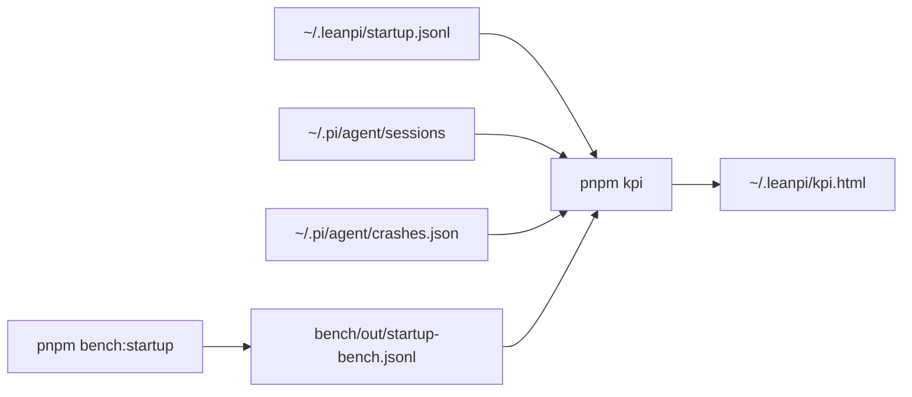

# UX KPIs

`pnpm kpi` computes these from local logs and writes the dashboard to `~/.leanpi/kpi.html`. `pnpm bench:startup` runs the controlled startup bench. The `ux-kpi-loop` skill (`.claude/skills/ux-kpi-loop/`) improves them one change at a time. Plan: [PRD-054](../PRDs/v1/PRD-054-ux-kpis.md).

| KPI | Definition | Target |
|---|---|---|
| Time to ready p50 / p90 | Shell command to the first editor frame (`editor-painted` mark, `src/cli/startup-trace.ts`) | ≤ 2500 ms / ≤ 5000 ms |
| First reply p50 | User message to the first finished assistant message | ≤ 10 s |
| Turns ending in error | Share of answered turns whose last assistant `stopReason` is `error` | ≤ 2% |
| Turns aborted | Same, `aborted` | ≤ 5% |
| Crashes | Entries in `~/.pi/agent/crashes.json` | 0 |

Targets live in `KPIS` in `scripts/ux-kpi.mjs`. Change both places together.

Startup phases: **launcher** (shell wrapper, build check, Node start, launcher imports), **pi boot** (Pi child until the LeanPi extension runs), **extensions + runtime** (the other extensions and the session), **paint** (session start to the first editor frame).

## Log

One line per loop iteration: date · KPI · lever · before → after (p50/p90) · kept/reverted · why.

- 2026-10-23 · time to ready · baseline, Pi 0.87.1 · bench p50 4822 ms / p90 9690 ms (5 runs, load 54, noisy) · — · first bench row.
- 2026-10-23 · time to ready · combined PRD-055 Phase 1 candidate (wrapper, built extensions, lazy imports) · baseline 1695/1773 ms → candidate 2323/2918 ms (p50/p90; 10 runs each, joao-cachyos, Pi 1.4.0; recorded pre-run load 4.75, post-run 13.27) · reverted · p50 rose 628 ms and p90 rose 1145 ms; retry the three stacked levers individually with comparable before/after measurements.
- 2026-10-23 · time to ready · wrapper one Node · 1745/2128 ms → 1569/1608 ms (p50/p90; 10 runs each, joao-cachyos, Pi 1.4.0; load at start 3.40/4.53) · kept · p50 fell 176 ms (10.1%), p90 fell 520 ms, launcher phase p50 fell 131 ms.
- 2026-10-23 · time to ready · lazy optional imports · 1601/1674 ms → 1694/1728 ms (p50/p90; 10 runs each, joao-cachyos, Pi 1.4.0; load at start 2.21/7.34) · reverted · p50 rose 93 ms and p90 rose 54 ms; skipping optional imports on informational launches did not offset the normal-launch import overhead.
- 2026-10-23 · time to ready · built-JavaScript default extension entries · no candidate measurement · no change · blocked before implementation: Pi 1.4.0's native ESM loading bypasses virtual modules and breaks class identity; identity-safe CommonJS still uses jiti transpilation, and dependency TypeScript cannot be relocated safely.
- 2026-10-23 · time to ready · in-process Pi handover · 1648/1683 ms → 1371/1946 ms (p50/p90; 10 runs each, joao-cachyos, Pi 1.4.0; load at start 2.25/6.15) · reverted · p50 fell 277 ms (16.8%), but p90 rose 263 ms (15.6%), failing the no-regression gate.
- 2026-10-23 · time to ready · precompiled default-extension sidecars (AC-4) · 1648/1683 ms → 1422/1448 ms (p50/p90; 10 runs each, joao-cachyos, Pi 1.4.0; load at start 2.25/9.77) · kept · p50 fell 226 ms (13.7%), p90 fell 235 ms (14.0%); all 100/100 `pi_timing` module-import paths ended in `.js`, with prototype and relocated-package checks passing.
- 2026-10-23 · time to ready · isolate learned-model cache from CLI provider imports · 1382/1397 ms → 1012/1030 ms (p50/p90; 10 runs each, Pi 1.4.0) · kept · p50 fell 370 ms (26.8%), p90 fell 367 ms (26.3%), and launcher p50 fell 374 ms; lightweight import test passed.
- 2026-10-23 · time to ready · reuse Pi SDK bridge in subagents · 1012/1030 ms → 927/943 ms (p50/p90; 10 runs each, Pi 1.4.0) · reverted · p50 fell 85 ms (8.4%), below the 10% run-spread threshold despite a better p90.
- 2026-10-23 · KPI integrity · exclude startup-bench warm-ups · 174 → 162 launches; ready p50/p90 2556/9193 ms → 2619/9491 ms · kept · backfilled 12 exact warm-up timestamps from startup traces; future summaries now record warm-up `t0` for exclusion, with a regression test proving measured percentiles stay unchanged.
- 2026-10-23 · KPI integrity · count one painted startup per `t0` · 162 → 147 launches; ready p50/p90 2619/9491 ms → 2470/6465 ms · kept · 15 later paint rows across 14 origins reused the original `node-start`; first eligible paint now represents each launch. The 15 slowest unique launches predate the retained optimizations, so no further p90 code lever is supported by this sample.
- 2026-10-23 · time to ready · skip Pi package-manager import/resolve when no package or extension sources are configured/discoverable · 997/1003 ms → 975/999 ms (p50/p90; 10 runs each; joao-cachyos, Pi 1.4.0; load at start 4.35/17.99) · reverted · p50 improved 2.2% and p90 0.4%, below the 10% keep gate.
- 2026-10-23 · time to ready · lazy `jevWarning` import · 958/1009 ms → 991/1021 ms (p50/p90; 10 runs each; Pi 1.4.0; desktop load 6.19/24, 91–92% idle) · reverted · focused warning test passed, but p50 rose 3.4% and p90 rose 1.2%; neither gate passed.
- 2026-10-23 · abort rate · 7-day trace audit · 5.26% (1/19 turns) → no code change · the sole recent abort had explicit `stopReason: aborted` after 50.9 s and five tool-use steps; existing outcome handling and cancellation tests distinguish it from provider errors, so no code defect is supported.
- 2026-10-23 · time to ready · Node persistent compile cache (`NODE_COMPILE_CACHE`) · 998/1022 ms → 926/934 ms (p50/p90; 10 runs each; desktop Node 24.16.0, load 1.62 before pair) · reverted (environment-only trial) · p50 fell 7.2%, below the 10% gate, while p90 fell 8.6%; the 7.8 MB cache survived the benchmark’s SIGTERM warm-ups, but the measured gain still missed the keep threshold.
- 2026-10-23 · time to ready · replace `pi auth check --provider opencode-go --json --no-refresh` (~200 ms synchronous startup in CPU profile) with `piAuthenticatedProviders()` · no benchmark claim · rejected · the helper only reads `auth.json` keys, while `pi auth check` validates credential shape, handles malformed auth data, and recognizes `OPENCODE_API_KEY` environment auth; the installed package does not export that CLI readiness helper, so parity would mean coupling to private internals. No code or test changes.
- 2026-10-23 · time to ready · defer auth warning probe from launcher to async post-paint `session_start` · 947/982 ms → 785/809 ms (p50/p90; 10 runs each; joao-cachyos, Pi 1.4.0; load 0.74/1.32/1.47, Tctl 60.6°C → 0.61/1.18/1.39, Tctl 48.5°C) · kept · p50 fell 17.1% and p90 17.6%; exact `pi auth check --no-refresh` retained, with interactive notification and `--print` stderr covered by tests.
- 2026-10-23 · time to ready · current PRD-055 worktree verification · 811/821 ms → 804/813 ms (p50/p90; 10 runs each; load 6.94 → 4.18) · no code change · same HEAD stayed within 1% across runs and below the 2.5 s p50 / 5 s p90 targets.
- 2026-10-23 · crashes · 30-day provenance audit · 1 → no code change · the sole in-window crash is a 2026-09-23 `ENOSPC` record on version `0.87.1` in the main checkout, with no stack frame or startup-bench overlap; no current code cause is supported.
